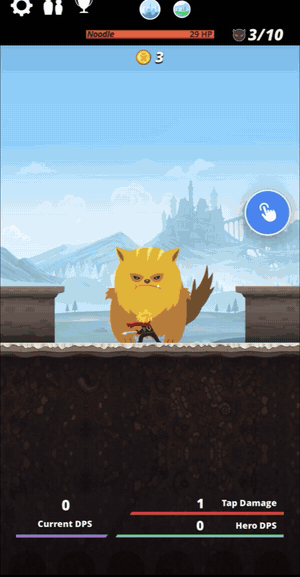

# AutoTap

An auto clicker you inject into an app as a `.dylib`. It's built on TouchSynth.

<p align="center">
  
  <br>
  <a href="../../docs/media/autotap-demo.mp4">Watch the full-quality video</a>
</p>

- **Steps:** record tap points and swipes directly on screen.
- **Timing:** set the delay after each tap, the delay after each swipe, and how long a swipe takes.
- **Repeats:** loop forever, or a set number of times.
- **Feedback:** numbered markers show each step, and ripples and swipe trails show every synthesized touch, so it reads well in a screen recording.

## Get the dylib

**[Download AutoTap.dylib from the latest release](https://github.com/Gladimore/TouchSynth/releases/latest).**

Every push also builds it with GitHub Actions, as the **AutoTap-dylib** artifact of each run. Downloading artifacts needs a GitHub login.

To build it yourself, you need Theos:

```bash
make -C Examples/AutoTap FINALPACKAGE=1
```

The output is `Examples/AutoTap/.theos/obj/arm64/AutoTap.dylib`.

## Inject

In Sideloadly, open the app's IPA, choose **Advanced options → Inject dylibs/frameworks**, add `AutoTap.dylib`, and sign. Other injectors such as ESign or TrollFools work the same way. AutoTap has no Substrate dependency.

## Use

1. Tap the floating hand button to open the panel.
2. Tap **Record**. Tap anywhere to add a tap step, or drag to add a swipe. Tap **Done** when finished.
3. Set the delays, swipe time and repeat count.
4. Tap **Start**. The panel hides and the floating button shows a spinning ring. Tap the floating button again to stop.

- **Editing:** drag a numbered marker to move a step, or drag a swipe's small end dot to move where it ends. Delete single steps from the list, or use **Undo** and **Clear**.
- **Saving:** steps and settings are saved inside the app and come back the next time you open it.
- **Misses:** a red ripple means nothing in the app was under that point.

The panel and markers never block the touches: AutoTap is TouchSynth's `excludedView`, so taps under the floating button still reach the app. Runs stop when the app goes to the background.

## Tips for recording a demo

- Leave **Show touches** on so every tap and swipe is visible.
- Start the screen recording before tapping **Start**, then show the panel, record a few steps, and run it.
- A simple target helps, such as a counter or button-mashing game, so the effect of each tap is obvious.
